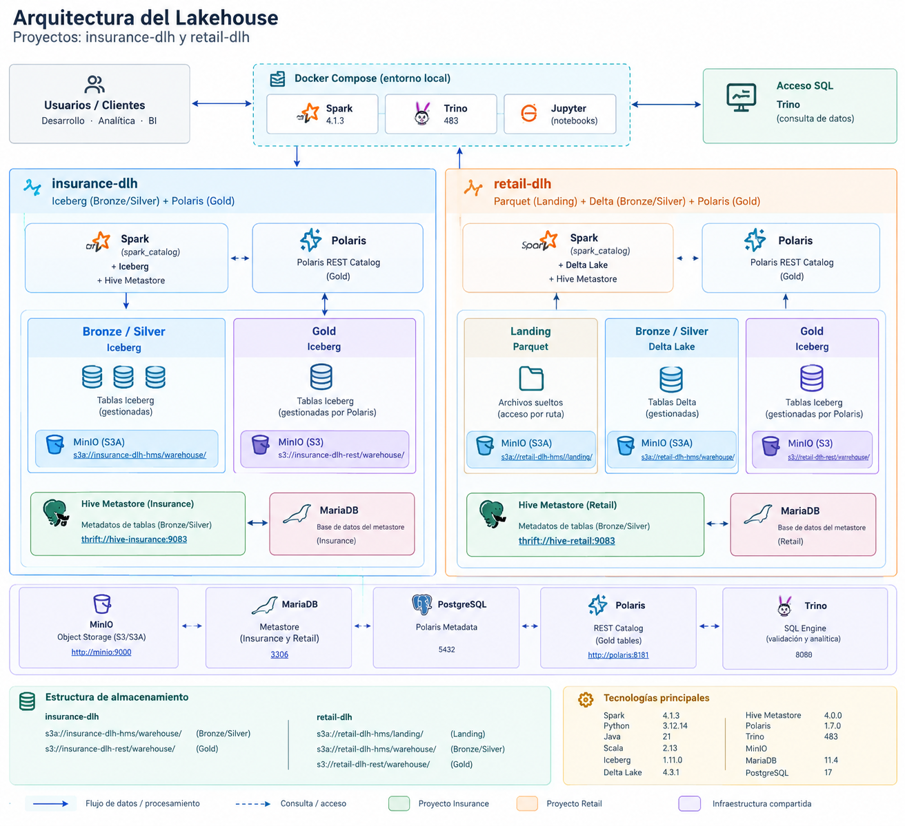

# Lakehouse Platform

*Nota: Este proyecto y su documentación se encuentran actualmente en desarrollo.*

Plataforma local de datos tipo **Data Lakehouse**, desplegada con Docker Compose. Integra Apache Spark, Apache Iceberg, Delta Lake, Hive Metastore, Polaris REST Catalog, Trino y MinIO para demostrar dos patrones de arquitectura.

- **`insurance-dlh`:** Iceberg en Bronze/Silver mediante Hive Metastore e Iceberg en Gold mediante Polaris REST Catalog.
- **`retail-dlh`:** archivos Parquet en Landing, Delta Lake en Bronze/Silver mediante Hive Metastore e Iceberg en Gold mediante Polaris REST Catalog.

> Proyecto de aprendizaje y portafolio técnico. El entorno está pensado para desarrollo local, no es una implementación lista para producción.

## Arquitectura




### Componentes principales

| Componente | Responsabilidad |
|---|---|
| Apache Spark | Procesamiento y transformación con PySpark |
| Apache Iceberg | Formato de tablas analíticas |
| Delta Lake | Formato de tablas para Retail Bronze/Silver |
| Hive Metastore | Metadatos de tablas Bronze/Silver |
| Polaris REST Catalog | Catálogo REST para las tablas Iceberg de Gold |
| Trino | Motor SQL para consultas y validación |
| MinIO | Almacenamiento de objetos compatible con S3 |
| MariaDB | Base de datos de los dos Hive Metastore |
| PostgreSQL | Base de datos de metadatos de Polaris |
| Docker Compose | Orquestación del entorno |
| Dev Container | Entorno de desarrollo reproducible |

## Proyectos de datos

### `insurance-dlh`

| Capa | Formato | Catálogo | Ubicación |
|---|---|---|---|
| Bronze | Iceberg | `spark_catalog` / Hive Metastore | `s3a://insurance-dlh-hms/warehouse/` |
| Silver | Iceberg | `spark_catalog` / Hive Metastore | `s3a://insurance-dlh-hms/warehouse/` |
| Gold | Iceberg | `polaris` / REST | `s3://insurance-dlh-rest/warehouse/` |

- **URI Thrift:** `thrift://hive-iceberg:9083`
- **Base de datos Hive Metastore en MariaDB:** `metastore_iceberg`
- **Base de datos de Polaris en PostgreSQL:** `polaris`

### `retail-dlh`

| Capa | Formato | Catálogo | Ubicación |
|---|---|---|---|
| Landing | Archivos Parquet | Acceso directo por ruta | `s3a://retail-dlh-hms/landing/` |
| Bronze | Delta Lake | `spark_catalog` / Hive Metastore | `s3a://retail-dlh-hms/warehouse/` |
| Silver | Delta Lake | `spark_catalog` / Hive Metastore | `s3a://retail-dlh-hms/warehouse/` |
| Gold | Iceberg | `polaris` / REST | `s3://retail-dlh-rest/warehouse/` |

- **URI Thrift:** `thrift://hive-delta:9083`
- **Base de datos Hive Metastore en MariaDB:** `metastore_delta`
- **Base de datos de Polaris en PostgreSQL:** `polaris`

Landing contiene archivos Parquet que Spark puede leer directamente mediante su ruta, sin registrar cada archivo en un catálogo. Bronze/Silver utilizan Hive Metastore; Gold utiliza Polaris para registrar las tablas Iceberg.

## Tecnologías

| Tecnología | Versión |
|---|---|
| Apache Spark | 4.1.3 |
| Python | 3.12.14 |
| Java | 21 |
| Scala | 2.13 |
| Apache Iceberg | 1.11.0 |
| Delta Lake | 4.3.1 |
| Hive Metastore | 4.0.0 |
| Polaris | 1.7.0 |
| Trino | 483 |
| MinIO | RELEASE.2025-09-07T16-13-09Z |
| MariaDB | 11.4 |
| PostgreSQL | 17 |

Confirma las versiones contra `docker-compose.yml`, los Dockerfiles y las dependencias instaladas antes de publicar cambios.

## Estructura del repositorio

```text
lakehouse/
├── .devcontainer/
│   └── devcontainer.json
├── code/
│   ├── common/
│   │   └── spark_session.py
│   └── projects/
│       ├── insurance-dlh/
│       └── retail-dlh/
├── config/
│   ├── hive_delta/
│   │   └── hive-site.xml
│   ├── hive_insurance/
│   │   └── hive-site.xml
│   ├── polaris/
│   │   └── insurance_assign_catalog_role.json
│   │   └── insurance_assign_spark_role.json
│   │   └── insurance_catalog.json
│   │   └── insurance_catalog_role.json
│   │   └── insurance_spark_principal.json
│   │   └── insurance_spark_role.json
│   │   └── retail_assign_catalog_role.json
│   │   └── retail_assign_spark_role.json
│   │   └── retail_catalog.json
│   │   └── retail_catalog_role.json
│   │   └── retail_spark_principal.json
│   │   └── retail_spark_role.json
│   ├── spark/
│   │   ├── log4j2.properties
│   │   └── spark-defaults.conf
│   └── trino/
│       └── catalog/
│           ├── delta.properties
│           ├── iceberg.properties
│           ├── insurance.properties
│           ├── parquet.properties
│           └── retail.properties
├── docker/
│   ├── hive/
│   │   └── Dockerfile
│   └── spark/
│       └── Dockerfile
├── scripts/
│   ├── mariadb/
│   │   └── init_mariadb.sql
│   └── polaris/
│       └── config_polaris.txt
├── .env
├── docker-compose.yml
└── README.md
```

## Requisitos previos

- Docker Engine o Docker Desktop.
- Docker Compose v2.
- Git.
- Memoria y espacio en disco suficientes para Spark y los servicios auxiliares.
- VS Code y Dev Containers, si quieres utilizar el entorno configurado.

## Puesta en marcha

### 1. Clonar el repositorio

```bash
git clone <URL_DEL_REPOSITORIO>
cd lakehouse
```

### 2. Configurar variables de entorno

Configura `.env` con las variables requeridas por `docker-compose.yml`: credenciales de bases de datos, claves de MinIO, credenciales de Polaris, puertos y versiones de imágenes.

No publiques contraseñas, tokens ni claves reales. Para un repositorio público, añade un `.env.example` con valores ficticios y excluye `.env` del control de versiones.

### 3. Validar y levantar los contenedores

```bash
docker compose config
docker compose up -d --build
docker compose ps
```

Para revisar los registros:

```bash
docker compose logs --tail=100
```

Usa los nombres de servicio exactos definidos en `docker-compose.yml` al consultar los logs de un contenedor.

### 4. Inicializar y configurar servicios

1. Comprueba que MariaDB y PostgreSQL estén disponibles.
2. Revisa `scripts/mariadb/init_mariadb.sql` para confirmar que prepara las bases de datos y usuarios esperados.
3. Confirma las bases de datos de los Hive Metastore: `metastore_iceberg` para Insurance y `metastore_delta` para Retail.
4. Ejecuta los comandos de configuración de Polaris documentados en `scripts/polaris/config_polaris.txt`.
5. Confirma que Polaris use la base de datos `polaris` en PostgreSQL y tenga configurados los catálogos, roles, credenciales y ubicaciones de almacenamiento.
6. Verifica que existan los buckets de MinIO requeridos por los dos proyectos.

### 5. Ejecutar los flujos de datos

La configuración común de Spark se encuentra en `code/common/spark_session.py`. Los flujos específicos se organizan en:

```text
code/projects/insurance-dlh/
code/projects/retail-dlh/
```

Ejecuta los notebooks o scripts disponibles en cada proyecto siguiendo sus dependencias: lectura de datos, procesamiento Bronze, transformaciones Silver y publicación Gold. Los comandos concretos dependen de los puntos de entrada incluidos en esos directorios.

## Catálogos y almacenamiento

### Hive Metastore y `spark_catalog`

El catálogo `spark_catalog` se utiliza para las tablas Bronze/Silver. Cada proyecto debe conectarse a su propio servicio Hive Metastore:

| Proyecto | URI Thrift | Base de datos MariaDB |
|---|---|---|
| `insurance-dlh` | `thrift://hive-iceberg:9083` | `metastore_iceberg` |
| `retail-dlh` | `thrift://hive-delta:9083` | `metastore_delta` |

Los nombres `hive-iceberg` y `hive-delta` deben coincidir con los nombres de servicio o alias DNS definidos en Compose. La comunicación entre contenedores utiliza el puerto interno del servicio, no el puerto publicado en el host.

### Polaris REST Catalog

Polaris administra el catálogo REST de las tablas Iceberg de Gold. Su base de datos de metadatos es `polaris`, alojada en PostgreSQL.

Los warehouses lógicos de Polaris son:

- `insurance-dlh-rest`
- `retail-dlh-rest`

Las ubicaciones de Gold previstas son:

- Insurance: `s3://insurance-dlh-rest/warehouse/`
- Retail: `s3://retail-dlh-rest/warehouse/`

Los nombres lógicos de warehouse no son las rutas físicas completas. Mantén separados los warehouses y las credenciales de cada proyecto.

### MinIO

MinIO proporciona almacenamiento compatible con S3. Desde los contenedores se utiliza el endpoint interno definido en Compose —por ejemplo, `http://minio:9000` si el servicio se llama `minio`— y desde el equipo anfitrión se utiliza el puerto publicado.

| Proyecto | Uso | Ruta |
|---|---|---|
| Insurance | Bronze/Silver | `s3a://insurance-dlh-hms/warehouse/` |
| Insurance | Gold | `s3://insurance-dlh-rest/warehouse/` |
| Retail | Landing | `s3a://retail-dlh-hms/landing/` |
| Retail | Bronze/Silver | `s3a://retail-dlh-hms/warehouse/` |
| Retail | Gold | `s3://retail-dlh-rest/warehouse/` |

Asegúrate de que Spark, Trino y Polaris tengan configurados los endpoints, las credenciales y las opciones de acceso compatibles con cada cliente.

## Validación

Después de iniciar los servicios, comprueba que:

1. Ambos Hive Metastore arranquen y conecten con su base de datos MariaDB correspondiente.
2. Spark pueda crear, escribir y leer una tabla Iceberg en Insurance mediante `spark_catalog`.
3. Spark pueda crear, escribir y leer una tabla Delta en Retail mediante `spark_catalog`.
4. Spark pueda crear y consultar una tabla Iceberg mediante el catálogo REST `polaris`.
5. Trino pueda consultar tablas a través de los catálogos definidos en `config/trino/catalog/`.
6. Los archivos se escriban en los buckets y prefijos esperados de MinIO.
7. Los nombres de host y puertos sean accesibles desde la red Docker.

El destino de validación definido para Polaris es `polaris.test.events`, una vez creados el esquema `test` y la tabla `events`.

## Decisiones de diseño

- **Separación de proyectos:** Insurance y Retail tienen metastore, formatos y prefijos de almacenamiento diferenciados.
- **Dos formatos de tabla:** Iceberg y Delta Lake se demuestran en casos de uso distintos.
- **Catálogos por capa:** Hive Metastore respalda `spark_catalog` en Bronze/Silver; Polaris REST Catalog gestiona Iceberg en Gold.
- **Almacenamiento compatible con S3:** MinIO permite probar localmente sin una cuenta de nube.
- **Motor SQL independiente:** Trino permite validar el acceso desde un motor distinto de Spark.
- **Entorno reproducible:** Docker Compose y Dev Containers reducen las diferencias entre entornos de desarrollo.

## Seguridad y alcance

Este proyecto está pensado para desarrollo local y demostración técnica. Antes de usar un entorno similar en producción, habría que añadir y probar, entre otros elementos:

- Gestión segura y rotación de secretos.
- TLS y endurecimiento de red.
- Autenticación y autorización.
- Alta disponibilidad, respaldos y recuperación.
- Monitorización, alertas y procedimientos operativos.
- Pruebas automatizadas de integración y calidad de datos.

## Mejoras futuras

- Incorporar datasets de ejemplo y flujos de ingesta reproducibles.
- Añadir pruebas automáticas de conectividad y operaciones de lectura/escritura.
- Documentar reglas de transformación y controles de calidad.
- Incorporar métricas, linaje y observabilidad.
- Documentar procedimientos de respaldo y recuperación.

## Licencia

Añade la licencia elegida para el repositorio y revisa las licencias de las dependencias antes de publicar el proyecto.
